# Outil de gestion « Les Brunants »

Application web de gestion pour l'association **Les Brunants** (environ 230 adhérents) : adhérents, comptabilité, activités, prestataires et calendrier, dans un seul outil, sur le compte Google de l'association, **sans abonnement ni serveur**.

| | |
|---|---|
| **Version** | Lot 6c — octobre 2026, en mode entraînement avec les vrais adhérents |
| **Utilisateurs** | Le bureau (président, trésorière, coordinateur) |
| **Technologie** | Google Apps Script + Google Sheets, HTML / CSS / JavaScript, Chart.js, SheetJS |
| **Coût de fonctionnement** | 0 € (compte Google gratuit de l'association) |
| **Chef de projet** | Jeff Madeline — OrdiNovice · développement assisté par Claude (Anthropic) |

Dépôt **privé**. Une présentation anonymisée, réutilisable comme cas client, est dans [`docs/Presentation_vitrine.md`](docs/Presentation_vitrine.md).

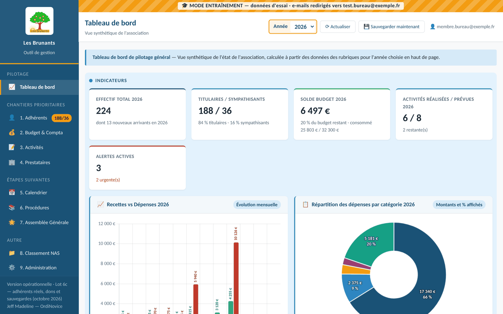

*Toutes les captures de ce dépôt montrent des données d'essai : les adhérents sont fictifs et portent des noms inventés. [Voir toutes les captures](docs/captures/LISEZMOI.md).*

---

## Sommaire

1. [Pourquoi ce projet](#1-pourquoi-ce-projet)
2. [Ce que fait l'outil](#2-ce-que-fait-loutil)
3. [Les avantages pour l'association](#3-les-avantages-pour-lassociation)
4. [Stack technique et architecture](#4-stack-technique-et-architecture)
5. [Le guide d'utilisation HTML](#5-le-guide-dutilisation-html)
6. [Données personnelles et sécurité](#6-données-personnelles-et-sécurité)
7. [Méthode : un développement assisté par l'IA](#7-méthode--un-développement-assisté-par-lia)
8. [Historique des versions](#8-historique-des-versions)
9. [Installer, mettre à jour, tester](#9-installer-mettre-à-jour-tester)
10. [Organisation du dépôt](#10-organisation-du-dépôt)
11. [Suite du projet](#11-suite-du-projet)

---

## 1. Pourquoi ce projet

Avant l'outil, la gestion de l'association reposait sur des fichiers séparés, tenus par quelques personnes :

- un **fichier Excel des adhérents**, tenu par une seule personne, avec des codes couleur et des lettres que lui seul savait lire ;
- des **tableaux comptables** à part, et donc une **double saisie** des paiements des activités ;
- un **calendrier partagé** à mettre à jour à la main ;
- aucune vue d'ensemble : le président devait demander les chiffres, et la mémoire de l'association dépendait de quelques personnes.

Le président a formalisé les besoins en juillet 2026. Ils ont donné 5 objectifs, repris dans le cahier des charges ([`docs/prompt-outil-operationnel.md`](docs/prompt-outil-operationnel.md)) :

1. **Alléger** les tâches récurrentes du bureau et du CA.
2. **Pérenniser et transmettre** : l'outil doit pouvoir être repris par quelqu'un d'autre.
3. **Une seule saisie** : plus de double tableau, plus d'oubli.
4. Rendre le président **autonome** sur l'information.
5. Rester **simple** : un MVP couvrant environ 80 % du besoin, puis des versions successives.

## 2. Ce que fait l'outil

Une page unique, 10 rubriques, et partout la même organisation en 3 zones : **Indicateurs** (bleu), **Saisie** (vert), **Listes** (jaune). L'année choisie en haut de page s'applique à toutes les rubriques.

| Rubrique | Fonctionnalités |
|---|---|
| **1. Tableau de bord** | Effectif, titulaires / sympathisants, solde budget, activités réalisées et prévues ; 3 graphiques chiffrés ; **alertes calculées** (paiements en retard, activités presque complètes, dépassements de budget, sauvegarde ancienne…) ; prochaines activités ; participation de l'association par membre |
| **2. Adhérents** | Fiche complète (coordonnées, région calculée, conjoint, Maillon papier, communications par mail, années JMB) ; contrôles (dates, codes postaux, e-mails, doublons) ; désinscription et décès → **archives**, réinscription ; filtre **« À compléter »** ; historique des activités suivies |
| **3. Budget & Compta** | Recettes et dépenses avec mode de paiement et **justificatif cliquable** (lien Drive) ; budgets prévisionnels par catégorie et suivi en temps réel ; solde budget ; 8 catégories et 27 sous-catégories du bureau, avec le texte « **Ce qu'elle recouvre** » affiché pendant la saisie |
| **4. Activités** | Fiche activité (prix, coût réel, participation de l'association calculée) ; inscriptions ; **paiements échelonnés** jusqu'à 12 échéances à dates personnalisables ; cocher « Payé » crée la recette, « Rembourser » crée une recette négative ; **mobil-home** avec aide plafonnée (60 €, 2 fois par an et par titulaire) ; fiche d'inscription générée en Google Doc + PDF ; notification par e-mail |
| **5. Prestataires** | Fiches, factures (dépenses liées), cumul et part de chaque prestataire, 10 principaux |
| **6. Calendrier** | Alimenté automatiquement par les activités et les dates d'échéances ; un clic ouvre l'activité |
| **7-8. Procédures, AG, Classement NAS** | Contenus du prototype, en attendant les besoins du bureau |
| **9. Administration** | Paramètres ; catégories ; **assistant d'import** CSV / Excel (correspondance des colonnes, contrôle ligne par ligne, test dans une copie) ; **sauvegardes, vérification et restauration** ; lignes à corriger ; journal des opérations |

Dans toutes les listes : recherche sans accents, filtres en tête de colonne, tri, Modifier / Supprimer avec confirmation, **export CSV**.

### L'outil en images

| | |
|---|---|
| 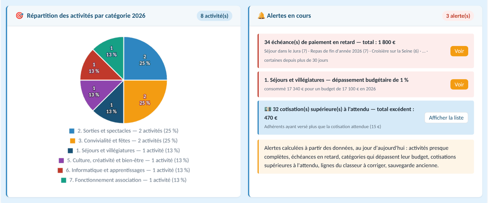 | 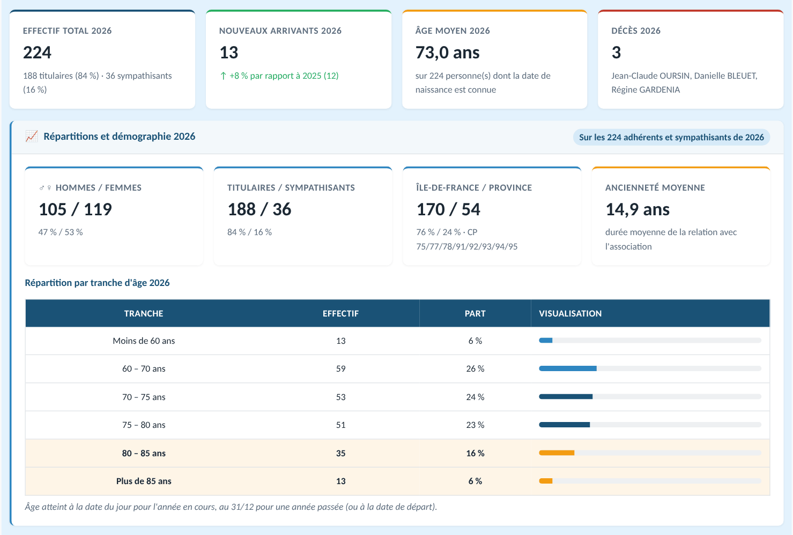 |
| **Tableau de bord** : répartition des activités et alertes calculées | **Adhérents** : effectif, âges, régions, ancienneté |
| 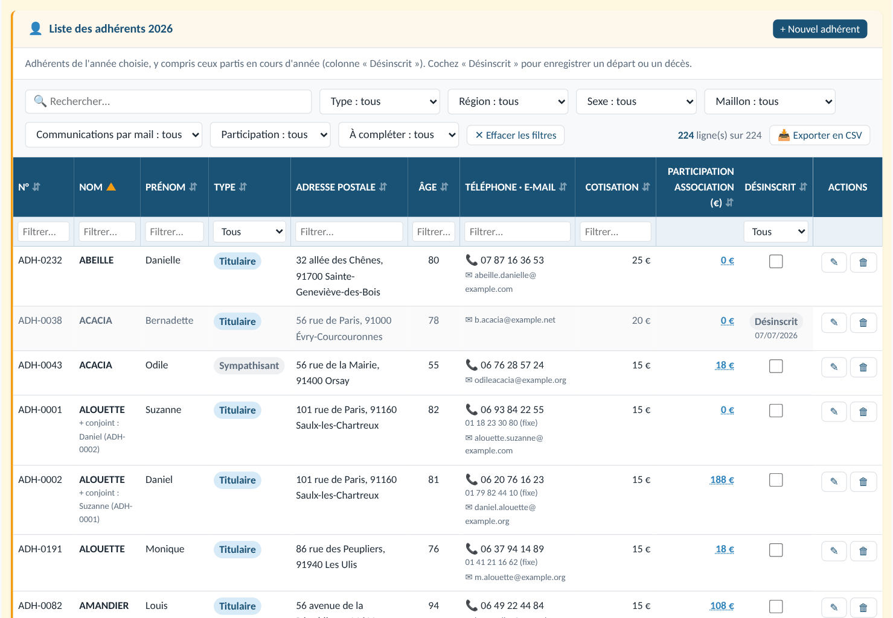 | 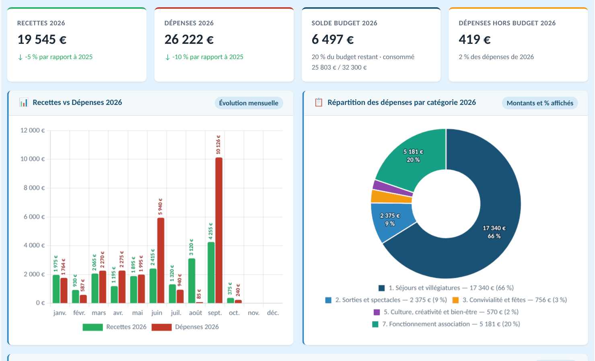 |
| **Liste des adhérents** : recherche, filtres, « À compléter », export CSV | **Budget & Compta** : recettes, dépenses, graphiques chiffrés |
| 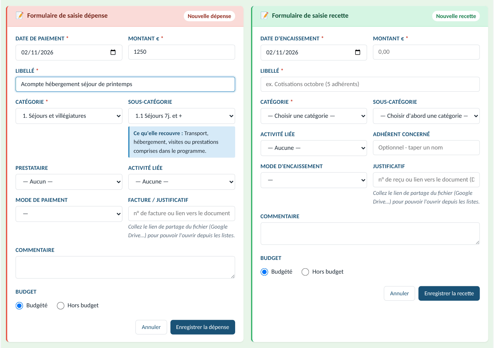 | 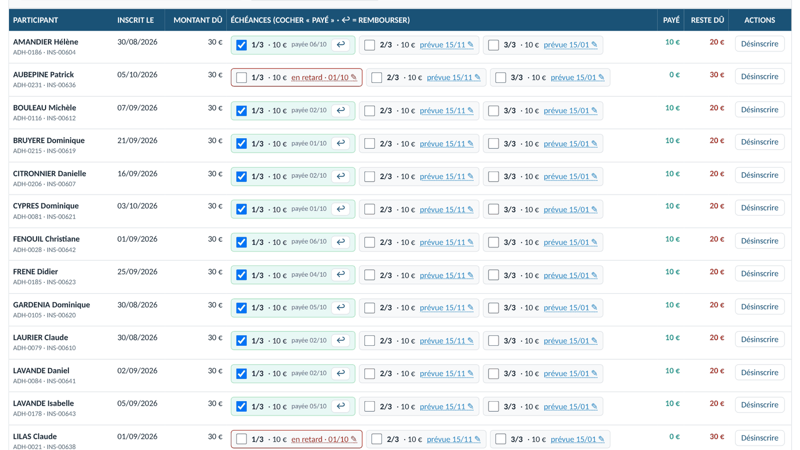 |
| **Saisie** : la sous-catégorie affiche « Ce qu'elle recouvre » | **Activités** : paiements échelonnés, retards, remboursements |
| 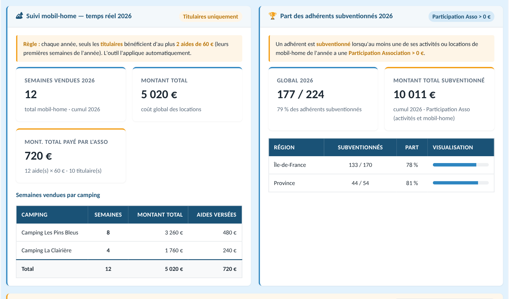 | 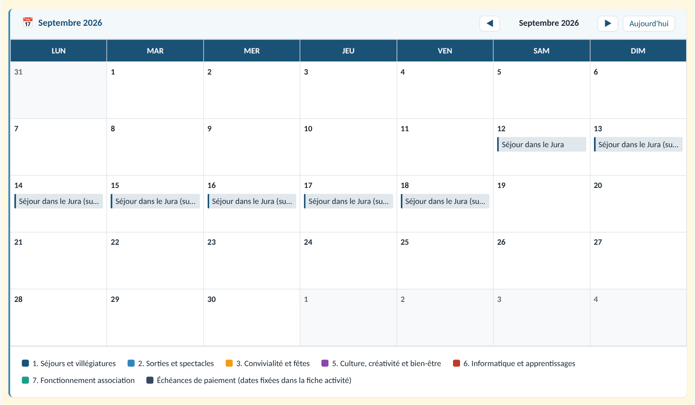 |
| **Mobil-home** : aide plafonnée appliquée automatiquement | **Calendrier** alimenté par les activités et les échéances |
| 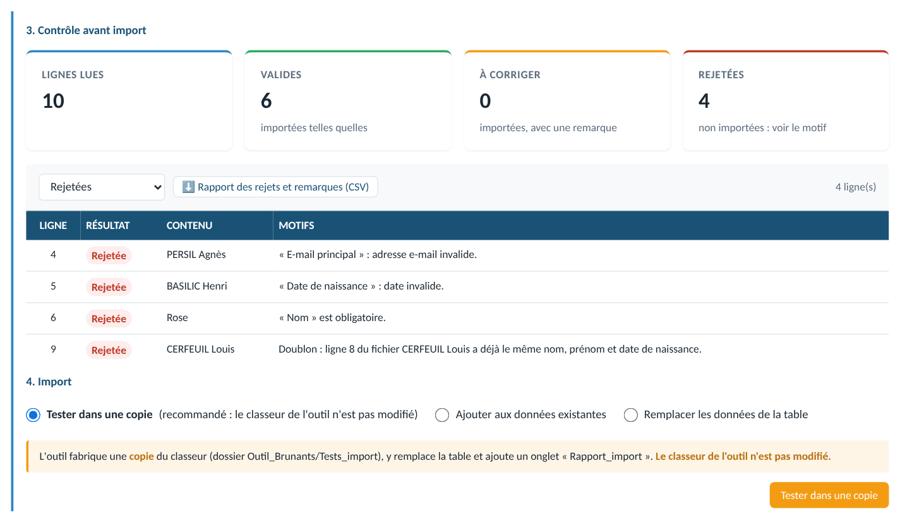 | 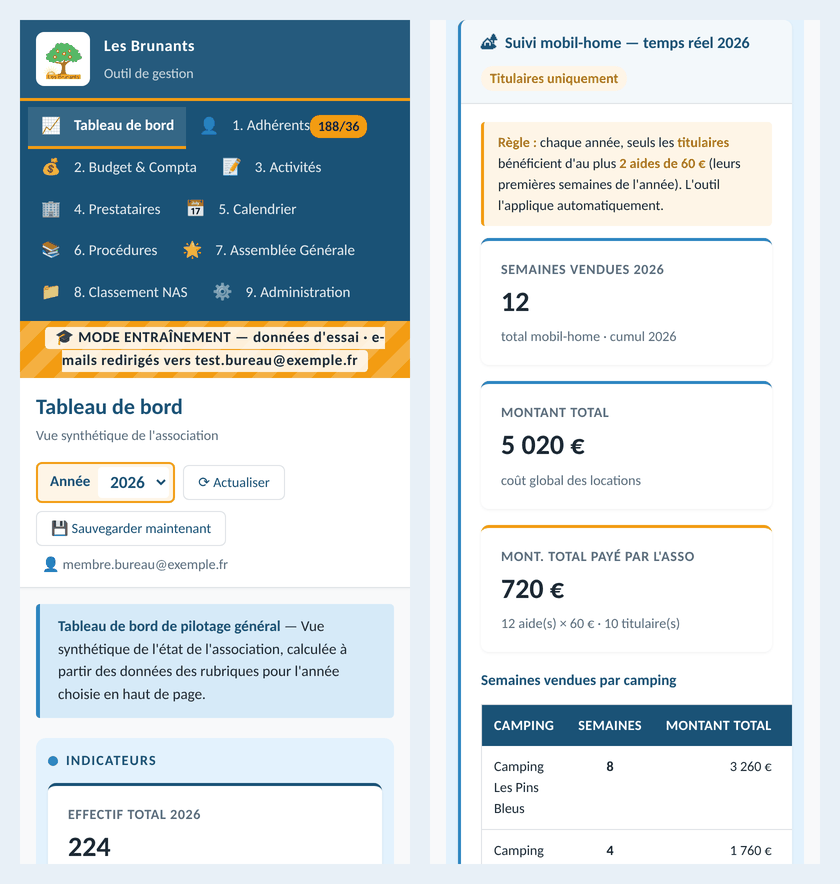 |
| **Assistant d'import** : contrôle ligne par ligne avant d'écrire | **Sur téléphone** : même outil, mise en page adaptée |

→ [Les 24 captures de l'outil et les 6 du guide](docs/captures/LISEZMOI.md)

## 3. Les avantages pour l'association

- **Une seule saisie.** Un paiement coché dans une activité crée la recette en comptabilité ; une location de mobil-home crée la dépense et la recette. Les chiffres sont toujours à jour.
- **Aucun coût, aucun serveur.** L'outil tourne sur le compte Google gratuit de l'association. Pas d'hébergement, pas d'abonnement, pas de maintenance de serveur.
- **Les données restent à l'association**, dans un classeur Google Sheets lisible par tous, exportable en Excel, et non dans un logiciel fermé.
- **Sauvegardes automatiques** chaque mois (copie + fichier .xlsx pour le NAS), 24 conservées, restauration en quelques clics.
- **Un mode entraînement** : bandeau visible, tous les e-mails redirigés vers une adresse de test, réinitialisation des données d'essai. On apprend sans risque, même avec les vrais adhérents dans l'outil.
- **Transmissible** : guide d'utilisation illustré, documentation d'installation, description de chaque table, tests automatiques. L'outil ne dépend plus de la mémoire d'une personne.
- **Accessible partout** : un navigateur suffit, sur ordinateur, tablette ou téléphone.
- **Robuste aux saisies à la main** dans le classeur : l'outil retrouve les colonnes par leur titre et signale les lignes illisibles au lieu de planter.

## 4. Stack technique et architecture

| Couche | Choix | Pourquoi |
|---|---|---|
| Interface | HTML, CSS, **JavaScript sans framework** (une page unique servie par `HtmlService`) | Aucune compilation, code lisible et modifiable par copier-coller |
| Graphiques | **Chart.js 4.4.1** + chartjs-plugin-datalabels 2.2.0 (cdnjs) | Montants et pourcentages écrits sur les graphiques |
| Lecture Excel | **SheetJS 0.18.5** (cdnjs), chargé à la demande | L'import lit les fichiers CSV et Excel dans le navigateur |
| Serveur | **Google Apps Script** (JavaScript V8) : HtmlService, LockService, PropertiesService, DriveApp, DocumentApp, MailApp, déclencheurs | Gratuit, intégré au compte Google, sans serveur à gérer |
| Données | **Google Sheets** : un classeur, 12 onglets, une ligne d'en-têtes en français, aucune formule indispensable | Lisible, exportable, sauvegardable ; les calculs sont faits par l'application |
| Tests | **Node.js** + simulateur des services Google (`outils/faux_gas.js`) ; **Python + Playwright** sur Chromium | Tester tout le code hors de Google, avant chaque livraison |

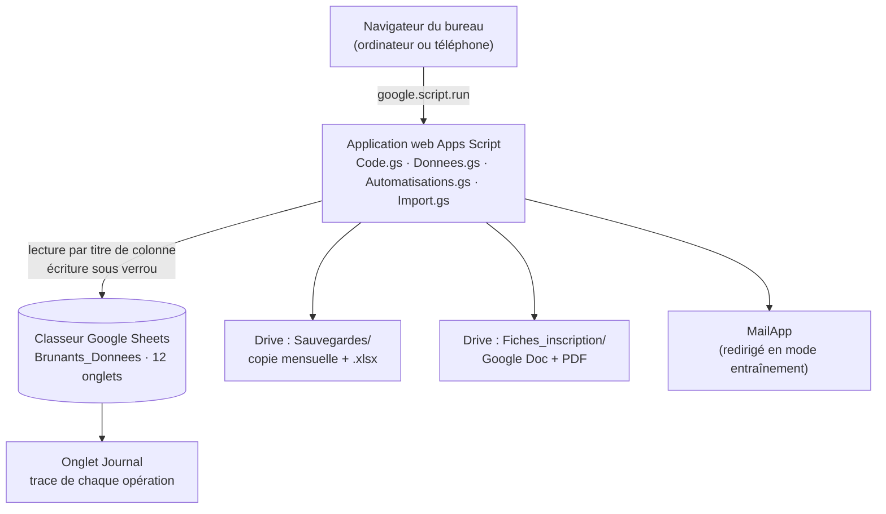

**Les 12 onglets** : Adherents, Activites, Inscriptions, Echeances, Recettes, Depenses, Categories, Budgets, Prestataires, MobilHome, Parametres, Journal. Les liens entre tables passent toujours par des identifiants lisibles (`ADH-0001`, `ACT-2026-001`, `REC-2026-0001`…). Le détail de chaque colonne est dans [`docs/Description_des_tables.md`](docs/Description_des_tables.md).

**Accès** : l'application s'exécute « en tant que l'utilisateur qui accède ». Seuls les comptes Google qui ont le dossier `Outil_Brunants` en partage peuvent ouvrir l'outil ; les autres voient « Accès refusé ».

## 5. Le guide d'utilisation HTML

[`livrables/guide/Guide_utilisation_Brunants.html`](livrables/guide/Guide_utilisation_Brunants.html) est le **mode d'emploi illustré** destiné au bureau.

- **Un seul fichier autonome** (environ 3 Mo) : images, styles et script intégrés. Il s'ouvre dans n'importe quel navigateur, **même sans internet**, sur ordinateur comme sur téléphone, et s'imprime proprement (une rubrique par page).
- **Accueil** avec une recherche libre (accents ignorés, synonymes), une entrée « **Je veux…** » pour les tâches courantes et un index par rubrique construit automatiquement.
- **Les bases** (écran, année, zones, listes, formulaires, sauvegarde, mode entraînement), puis **une partie par rubrique**, organisée comme l'outil : Indicateurs, Saisie, Listes, Tutos.
- **16 tutos illustrés**, dont les 10 exercices d'entraînement, un **glossaire de 39 termes** et **68 captures d'écran**, toutes prises avec les données fictives.
- **Ancres stables** (`#adh-liste`, `#act-suivi`, `#tuto-rembourser`…) et une petite interface JavaScript (`window.GuideBrunants.aller(id)`) : un futur bouton « ? » dans l'outil pourra ouvrir le guide au bon endroit.

| | |
|---|---|
| 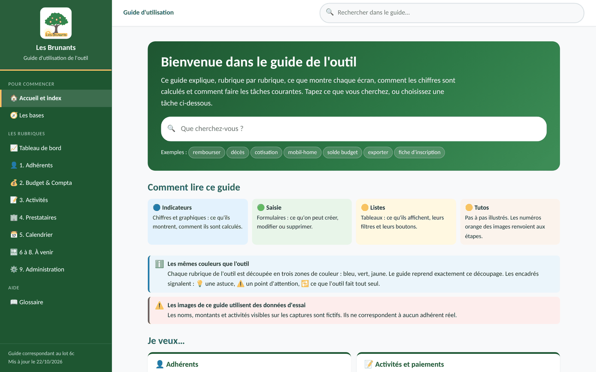 | 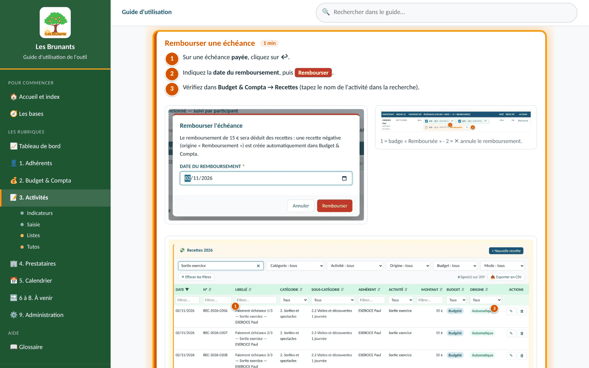 |
| **Accueil** : recherche, exemples, « Je veux… » | **Tuto** : étapes numérotées, captures annotées |
| 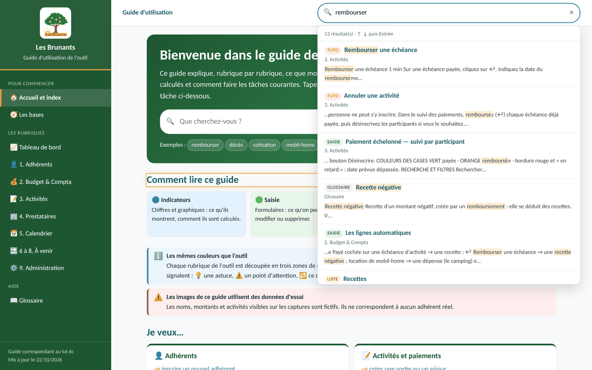 | 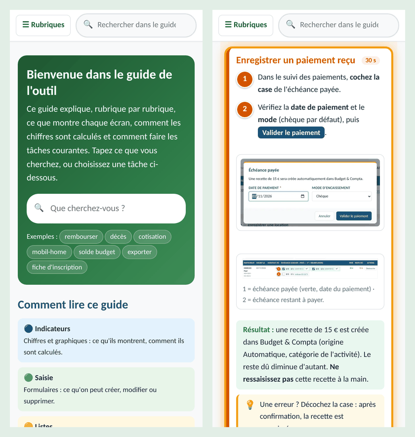 |
| **Recherche libre** : résultats classés par type | **Sur téléphone** : menu « Rubriques » et tutos lisibles |

**Pour l'ouvrir** : GitHub n'affiche pas une page HTML ; téléchargez le fichier (bouton « Download raw file ») puis double-cliquez dessus. Les sources et les scripts qui régénèrent le guide après chaque version (captures automatiques, assemblage, vérifications) sont dans [`guide/`](guide/LISEZMOI_Guide.md).

Une documentation complémentaire (installation et maintenance, prise en main avec 10 exercices, description des tables) a aussi été rédigée pour le bureau dans un document partagé claude.ai.

## 6. Données personnelles et sécurité

- **Aucune donnée personnelle réelle dans ce dépôt.** Les tests, l'aperçu local, le modèle d'import et les captures du guide n'utilisent que des données fictives (adresses e-mail en `example.com`). Le `.gitignore` bloque les fichiers d'adhérents, les sauvegardes et les fiches d'inscription.
- **Les captures d'écran** ([`docs/captures/`](docs/captures/LISEZMOI.md)) sont prises dans l'aperçu local, avec le jeu d'essai dont les noms de famille ont été remplacés par des noms inventés (plantes, oiseaux…) : aucune personne réelle n'y apparaît.
- Les vraies données vivent uniquement dans le classeur et les sauvegardes, sur le Drive de l'association, **partagés avec le seul bureau**.
- **Mode entraînement** : aucun e-mail ne part vers un adhérent tant qu'il est actif.
- **Garde-fous** : sauvegarde automatique avant chaque import, réinitialisation ou restauration ; double confirmation des opérations destructrices ; les vrais adhérents ne peuvent pas être effacés par la réinitialisation des données d'entraînement ; chaque opération est inscrite au journal.

## 7. Méthode : un développement assisté par l'IA

L'outil a été conçu par Jeff Madeline (OrdiNovice), chef de projet, et développé avec **Claude** (Anthropic). Le chef de projet décide et valide ; l'IA rédige le code, les tests et la documentation.

1. **Prototype d'abord** (été 2026) : une maquette HTML de 8 rubriques, revue avec le président, a fixé l'interface et le vocabulaire (« titulaires », « sympathisants », « Participation Association »).
2. **Un cahier des charges précis** ([`docs/prompt-outil-operationnel.md`](docs/prompt-outil-operationnel.md)) : données, règles de gestion, rubriques, critères d'acceptation, livrables.
3. **Un développement par lots** : chaque lot ajoute une partie de l'outil, sans réécrire ce qui existe. Il est livré avec un **assistant de mise à jour** (un bouton « Copier » par fichier modifié) et un **LISEZMOI** qui liste les tests à faire, avec les résultats attendus.
4. **Des tests automatiques avant chaque livraison** : un simulateur des services Google fait tourner le vrai code hors ligne. Les tests serveur (≈ 340 vérifications) et navigateur (≈ 370 vérifications, avec recalcul indépendant des indicateurs) sont **tous rejoués à chaque lot**. Les vrais fichiers sont aussi passés dans l'outil en local, sans jamais être publiés.
5. **La validation humaine à chaque étape** : le chef de projet installe le lot, fait les tests du LISEZMOI et tranche les questions ouvertes. Rien ne passe au lot suivant sans son accord.
6. **Une mémoire du projet** ([`memory-bank/`](memory-bank/00-LISEZ-MOI.md)) : contexte, état d'avancement, registre numéroté des décisions (DEC-001 à DEC-089), architecture, carte des fichiers, journal, questions ouvertes, procédures. Elle permet de reprendre le travail d'une conversation à l'autre, ou par une autre personne.

Ce que l'IA a apporté : la vitesse (7 lots et 3 lots de retouches en deux semaines), une couverture de tests qu'un projet associatif n'aurait pas eue autrement, et une documentation complète. Ce qu'elle n'a pas remplacé : la connaissance de l'association, les arbitrages et la validation sur le terrain.

## 8. Historique des versions

| Version | Date | Contenu |
|---|---|---|
| Prototype V1 → V5 | juillet – septembre 2026 | Maquette HTML autonome, 8 rubriques, données fictives ; présentée au bureau le 07/10/2026 |
| Lot 1 | octobre 2026 | Socle : installation `setup()`, 12 onglets, navigation, sélecteur d'année, listes génériques, journal, mode entraînement, sauvegardes |
| Lot 2 | octobre 2026 | Adhérents : fiche, liste, archives, désinscription / réinscription, indicateurs, historique |
| Lot 3 | octobre 2026 | Budget & Compta et Prestataires |
| Lot 4 | 12/10/2026 | Activités : inscriptions, échéances, recettes automatiques, mobil-home, fiche d'inscription, notification |
| Lots 4b, 4c | 18-19/10/2026 | Retouches du bureau, préparation et test de l'import des vrais adhérents |
| Lot 5 | 19/10/2026 | Tableau de bord, Calendrier, rubriques du prototype ; remboursement en recette négative, échéances personnalisables |
| Lot 6 | 19/10/2026 | Assistant d'import, sauvegardes et restauration, justificatifs cliquables |
| Lot 6b | 22/10/2026 | Catégories et sous-catégories du bureau, « Ce qu'elle recouvre » |
| Lot 6c | 22/10/2026 | Vrais adhérents importés et protégés, filtre « À compléter », 24 sauvegardes |
| Lot 7 | 22/10/2026 | Documentation et guide d'utilisation illustré |

Le détail de chaque lot est dans [`livrables/LISEZMOI_LotN.md`](livrables/) et dans [`memory-bank/06-journal-evolutions.md`](memory-bank/06-journal-evolutions.md).

## 9. Installer, mettre à jour, tester

- **Installer** : créer un classeur Google Sheets, ouvrir Extensions → Apps Script, copier les 21 fichiers avec [`livrables/Assistant_installation.html`](livrables/Assistant_installation.html), exécuter `setup`, puis Déployer → Application Web (procédure complète dans [`livrables/LISEZMOI_Lot1.md`](livrables/LISEZMOI_Lot1.md)).
- **Mettre à jour** : copier les fichiers modifiés avec l'assistant du lot, exécuter `setup`, puis Gérer les déploiements → Nouvelle version (l'adresse de l'outil ne change pas).
- **Essayer sans Google** : double-cliquer sur [`livrables/Apercu_local_Brunants.html`](livrables/Apercu_local_Brunants.html). Le vrai code tourne dans le navigateur avec des données fictives ; rien n'est enregistré.
- **Lancer les tests** : `node outils/test_serveur_lot6c.js` (et les autres lots), voir [`outils/LISEZMOI.md`](outils/LISEZMOI.md).

## 10. Organisation du dépôt

| Dossier | Contenu |
|---|---|
| [`apps_script/`](apps_script/LISEZMOI.md) | Les 21 fichiers de l'outil (version lot 6c) |
| [`outils/`](outils/LISEZMOI.md) | Simulateur Google, tests serveur et navigateur, générateurs des livrables, versions de référence |
| [`livrables/`](livrables/LISEZMOI.md) | Assistants d'installation et de mise à jour, LISEZMOI de chaque lot, aperçu local, modèle d'import, guide d'utilisation |
| [`guide/`](guide/LISEZMOI_Guide.md) | Sources et scripts de régénération du guide d'utilisation |
| [`docs/`](docs/) | Cahier des charges, compte rendu du prototype, description des tables, présentation vitrine, [captures d'écran](docs/captures/LISEZMOI.md) |
| [`memory-bank/`](memory-bank/00-LISEZ-MOI.md) | Mémoire du projet : état, décisions, architecture, journal, questions ouvertes |

**Ce qui n'est jamais dans ce dépôt** (voir `.gitignore`) : mots de passe et clés, **données personnelles réelles**, sauvegardes du classeur, fiches d'inscription remplies, fichiers lourds et temporaires.

**Règles de commit** : un commit par étape cohérente, message en français au présent (`Lot 5 : tableau de bord et calendrier`).

## 11. Suite du projet

1. **Phase de test** par le bureau, avec le guide et les 10 exercices.
2. **Passage complet au réel** : vider les activités et comptes d'entraînement, saisir les vrais, couper le mode entraînement.
3. **Listes de diffusion Gmail**, pour envoyer une annonce à tous sans dépasser le quota d'environ 100 e-mails par jour.
4. **Rubriques à définir** avec le bureau : Procédures, Assemblée Générale (inscriptions, sondages), accès en lecture pour le CA.
5. **Volet RGPD** : responsable du fichier, durée de conservation des archives.

---

*Outil conçu et piloté par Jeff Madeline — OrdiNovice (Saulx-les-Chartreux) · développé avec Claude (Anthropic) · 2026.*
